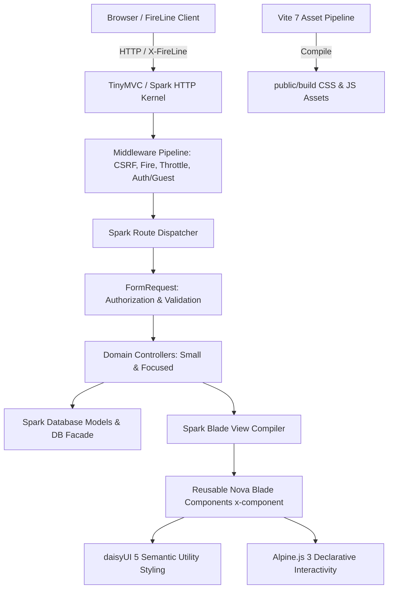

# Nova Architecture Reference

Nova is a clean, lightweight, production-conscious starter kit built natively for the **TinyMVC / Spark** PHP framework. It provides developers with a robust foundation containing pre-built Blade components, secure authentication flows, responsive administrative dashboard layouts, and a modern frontend stack powered by Tailwind CSS 4, daisyUI 5, Alpine.js 3, FireLine 2.1, and Vite.

---

## 1. Framework Taxonomy & Architectural Roles

To maintain strict alignment with the framework design:

| Component | Architecture Role | Description |
| --- | --- | --- |
| **`tinymvc`** | Vendor Namespace | The vendor prefix for all official packages on GitHub and Packagist. |
| **`tinymvc/spark` (Spark)** | Root Framework | The developer-facing framework interface utilizing the `Spark\` PHP namespace alias, static facades (`Spark\Facades\*`), contracts, and the `php spark` CLI runner. |
| **`tinymvc/tinycore` (TinyCore)** | Core Engine | The core runtime engine installed at `vendor/tinymvc/tinycore`, providing container, routing, database ORM, view compiler, sessions, hashing, and queue drivers. |
| **`tinymvc/skeleton`** | Boilerplate | The standard application scaffolding. Nova builds on top of this skeleton to provide a ready-to-run starter kit. |
| **`tinymvc/fireline-php`** | SPA/Turbo Adapter | Official TinyMVC adapter for FireLine JS 2.1, providing seamless partial DOM updates over server-rendered Blade templates. |

---

## 2. Directory Structure

```text
nova/
├── app/
│   ├── Http/
│   │   ├── Controllers/
│   │   │   ├── Auth/
│   │   │   │   ├── AuthenticatedSessionController.php
│   │   │   │   ├── RegisteredUserController.php
│   │   │   │   ├── PasswordResetLinkController.php
│   │   │   │   └── NewPasswordController.php
│   │   │   ├── Controller.php
│   │   │   ├── DashboardController.php
│   │   │   ├── HomeController.php
│   │   │   └── ProfileController.php
│   │   ├── Middlewares/
│   │   │   ├── AuthMiddleware.php
│   │   │   ├── CorsControl.php
│   │   │   ├── CsrfProtectionMiddleware.php
│   │   │   ├── GuestMiddleware.php
│   │   │   └── ThrottleMiddleware.php
│   │   └── Requests/
│   │       ├── Auth/
│   │       │   ├── LoginRequest.php
│   │       │   ├── RegisterRequest.php
│   │       │   ├── ForgotPasswordRequest.php
│   │       │   └── ResetPasswordRequest.php
│   │       └── ProfileUpdateRequest.php
│   ├── Models/
│   │   └── User.php
│   └── Providers/
│       ├── AppServiceProvider.php
│       └── ConsoleServiceProvider.php
├── bootstrap/
│   ├── app.php
│   ├── middlewares.php
│   └── providers.php
├── config/
│   ├── app.php
│   ├── auth.php
│   ├── database.php
│   ├── mail.php
│   └── session.php
├── database/
│   ├── migrations/
│   └── sqlite.db
├── docs/
│   ├── architecture.md
│   ├── implementation-plan.md
│   ├── components.md
│   └── authentication.md
├── resources/
│   ├── app/
│   │   ├── app.css
│   │   └── app.js
│   └── views/
│       ├── auth/
│       │   ├── forgot-password.blade.php
│       │   ├── login.blade.php
│       │   ├── register.blade.php
│       │   └── reset-password.blade.php
│       ├── components/
│       │   ├── layouts/
│       │   │   ├── app.blade.php
│       │   │   ├── auth.blade.php
│       │   │   └── guest.blade.php
│       │   ├── alert.blade.php
│       │   ├── avatar.blade.php
│       │   ├── badge.blade.php
│       │   ├── breadcrumb.blade.php
│       │   ├── button.blade.php
│       │   ├── card.blade.php
│       │   ├── checkbox.blade.php
│       │   ├── confirm-dialog.blade.php
│       │   ├── divider.blade.php
│       │   ├── dropdown.blade.php
│       │   ├── empty-state.blade.php
│       │   ├── error.blade.php
│       │   ├── flash.blade.php
│       │   ├── help.blade.php
│       │   ├── icon.blade.php
│       │   ├── input.blade.php
│       │   ├── label.blade.php
│       │   ├── link.blade.php
│       │   ├── loading.blade.php
│       │   ├── modal.blade.php
│       │   ├── page-header.blade.php
│       │   ├── pagination.blade.php
│       │   ├── radio.blade.php
│       │   ├── select.blade.php
│       │   ├── skeleton.blade.php
│       │   ├── table.blade.php
│       │   ├── textarea.blade.php
│       │   ├── toggle.blade.php
│       │   └── tooltip.blade.php
│       ├── dashboard/
│       │   └── index.blade.php
│       ├── profile/
│       │   └── edit.blade.php
│       ├── emails/
│       │   └── password-reset.blade.php
│       └── welcome.blade.php
├── routes/
│   ├── console.php
│   └── web.php
├── tests/
│   ├── Feature/
│   │   ├── Auth/
│   │   │   ├── AuthenticationTest.php
│   │   │   ├── PasswordResetTest.php
│   │   │   └── RegistrationTest.php
│   │   ├── ComponentTest.php
│   │   ├── DashboardTest.php
│   │   ├── HomeTest.php
│   │   └── ProfileTest.php
│   ├── TestCase.php
│   └── config.php
├── package.json
└── vite.config.js
```

---

## 3. Technology Stack & Component Interactions



### 3.1 Styling: Tailwind CSS 4 + daisyUI 5
- **Tailwind CSS 4**: Uses Vite native plugin `@tailwindcss/vite` and `@import "tailwindcss";` in `resources/app/app.css`.
- **daisyUI 5**: Direct Tailwind CSS 4 plugin integration via `@plugin "daisyui";`. Eliminates legacy `tailwind.config.js` requirements.
- **Theme tokens**: Consistent use of semantic classes (`btn`, `btn-primary`, `card`, `alert`, `input`, `badge`, `modal`) mapping cleanly to configurable daisyUI themes (e.g. `light`, `dark`, `corporate`).

### 3.2 Interactivity: Alpine.js 3 + FireLine 2.1
- **Alpine.js**: Handles local DOM state (modals, dropdowns, mobile navigation drawer toggle, password visibility toggle) without heavyweight client frameworks.
- **FireLine 2.1**: Registered via `Alpine.plugin(FireLine)`. Transparently intercepts anchor clicks (`x-navigate`) and forms (`x-form`, `x-submit`), exchanging JSON render envelopes (`{ html, title }`) for fast partial-DOM updates while preserving native browser history.
- **Dual Compatibility**: Blade layouts work seamlessly both as traditional multi-page applications (MPA) and when dynamically updated through FireLine.

---

## 4. Backend Architecture Decisions

### 4.1 Routing & Route Model Binding
- All web routes are defined in `routes/web.php` using the static facade `Spark\Facades\Route`.
- Routes are explicitly named (`->name('login')`, `->name('dashboard')`) to allow type-safe URL generation with `route('name')`.
- Authenticated routes are protected with `->middleware('auth')`.
- Guest routes (login, register, forgot-password) are protected with `->middleware('guest')`.

### 4.2 Middleware Pipeline
- `bootstrap/app.php` configures the global middleware queue:
  1. `\Spark\Fire\FireMiddleware::class` (manages FireLine request headers and validation response formatting)
  2. `'csrf'` (`\App\Http\Middlewares\CsrfProtectionMiddleware::class`)
- Route-specific middleware registered in `bootstrap/middlewares.php`:
  - `'auth'` (`\App\Http\Middlewares\AuthMiddleware::class`): ensures user is authenticated; redirects unauthenticated web users to `route('login')`.
  - `'guest'` (`\App\Http\Middlewares\GuestMiddleware::class`): ensures user is unauthenticated; redirects logged-in users to `route('dashboard')`.
  - `'throttle'` (`\App\Http\Middlewares\ThrottleMiddleware::class`): prevents brute-force abuse on authentication endpoints.

### 4.3 FormRequest & Input Validation
- All state-altering operations use dedicated `Spark\Foundation\Http\FormRequest` classes (`LoginRequest`, `RegisterRequest`, `ForgotPasswordRequest`, `ResetPasswordRequest`, `ProfileUpdateRequest`).
- `$request->validated()` returns a fluent `Spark\Http\Input` instance implementing `Arrayable`, passed directly to `Model::create()` or `Auth::attempt()`.
- On validation failure in standard web requests, TinyCore flashes errors to the session and redirects `back()`. Errors are consumed in Blade via `@error('field')` and the `<x-error>` component.

### 4.4 Authentication & Security Architecture
- **Session Authentication**: Managed via `Spark\Facades\Auth`.
- **Session Fixation Defense**: Calls `Session::regenerate()` upon successful sign in to replace the session ID before storing credentials.
- **Session Invalidation**: Calls `Session::invalidate()` and `Auth::logout()` upon sign out.
- **Password Hashing**: Always utilizes `Spark\Facades\Hash::make()` with bcrypt / argon2id. The `User` model defines `'password' => 'hashed'` in its cast array.
- **Password Reset Lifecycle**:
  - Uses the framework's existing `password_reset_tokens` table (`email`, `token`, `created_at`).
  - Generates cryptographically secure 64-character random tokens using `Spark\Support\Str::random(64)`.
  - Enforces a 60-minute token expiration check via `Spark\Carbon` arithmetic: `carbon($record->created_at)->addMinutes(60)->isPast()`.
  - Tokens are single-use: immediately deleted upon successful password reset.
  - Generic user feedback prevents email enumeration ("If an account exists with that email, a password reset link has been sent.").
- **Rate Limiting**: Critical endpoints (login attempt, password reset request) apply throttle middleware to protect against credential stuffing.
